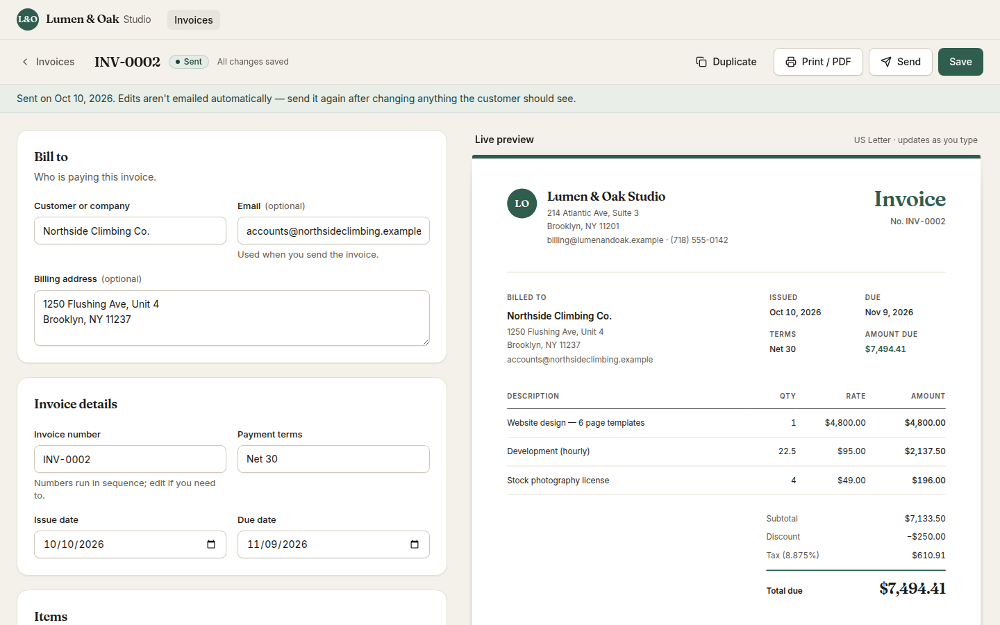
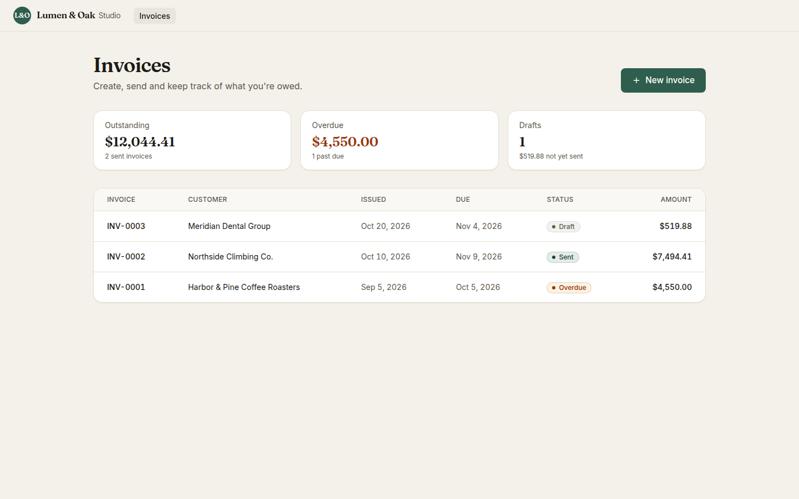
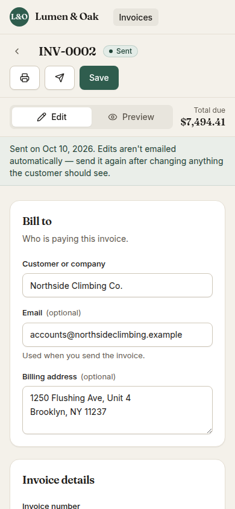
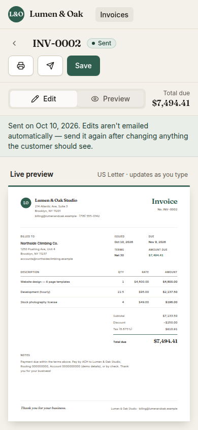

# Customizable Invoice Generator

A browser-based invoicing tool for a small business. You fill in a form, a live preview shows the invoice at true US Letter size as you type, and you can save it, print it or save it as a PDF, and email it to the customer.



| Invoices | Phone: edit | Phone: preview |
| --- | --- | --- |
|  |  |  |

A sample of the printed output is in [`docs/sample-invoice.pdf`](docs/sample-invoice.pdf).

## Contents

- [Quick start](#quick-start)
- [Email setup](#email-setup)
- [Storage](#storage)
- [What's included](#whats-included)
- [How totals are calculated](#how-totals-are-calculated)
- [Architecture](#architecture)
- [API](#api)
- [Decisions and trade-offs](#decisions-and-trade-offs)
- [Assumptions](#assumptions)
- [Testing](#testing)
- [AI tools used](#ai-tools-used)
- [Time spent](#time-spent)
- [Unfinished work and next steps](#unfinished-work-and-next-steps)

## Quick start

Requirements: **Node.js 24 LTS** (22.22 or newer works) and npm. The repo has an `.nvmrc`, so `nvm use` picks the right version.

```bash
cp .env.example .env    # works as-is; emails go to a free Ethereal test inbox
npm install
npm run db:seed         # optional: three realistic demo invoices
npm run dev             # web: http://localhost:5173 · API: http://localhost:3001
```

Open <http://localhost:5173>.

To run the production build (Express serves the API and the built web app on one port):

```bash
npm run build
npm start               # http://localhost:3001
```

| Script | What it does |
| --- | --- |
| `npm run dev` | API (tsx watch) and web (Vite) together |
| `npm run build` / `npm start` | Production build, then a single Node server on `PORT` |
| `npm test` | Unit tests (shared domain) and API tests (Vitest + supertest) |
| `npm run test:e2e` | Browser tests (Playwright + axe), desktop and phone |
| `npm run lint` / `npm run typecheck` | oxlint and TypeScript across all workspaces |
| `npm run db:seed` / `npm run db:reset` | Add demo data / wipe and re-seed |

## Email setup

The API sends invoice emails over SMTP with Nodemailer. Which transport it uses depends on `.env`:

| `.env` | Email mode | What happens |
| --- | --- | --- |
| `SMTP_HOST` and `SMTP_PASS` set | **smtp** | Real delivery through your provider |
| SMTP not configured (the default) | **ethereal** | Captured by a free [Ethereal](https://ethereal.email) test inbox; the app shows a **View email** link after sending. Nothing is delivered, so reviewers can try the flow without any account. |
| `EMAIL_MODE=json` (used by tests) | **json** | Nothing leaves the process |

**Resend (used during development).** Create a free account at [resend.com](https://resend.com), create an API key with *Sending access*, then set:

```bash
SMTP_HOST=smtp.resend.com
SMTP_PORT=465
SMTP_SECURE=true
SMTP_USER=resend
SMTP_PASS=re_your_api_key
EMAIL_FROM="Lumen & Oak Studio <onboarding@resend.dev>"
```

Until you verify a domain, Resend's `onboarding@resend.dev` sender only delivers to the address you signed up with. That makes it impossible to email anyone you don't control by accident. To email real customers, verify a domain in Resend and change `EMAIL_FROM`.

Any other SMTP service (Postmark, Mailgun, Amazon SES, a Gmail app password) works with the same variables. Credentials are read only by the API. The browser never sees them, and `.env` is git-ignored.

## Storage

Invoices are stored in **SQLite** (`better-sqlite3` + Drizzle ORM). The database file is created automatically at `DATABASE_PATH` (default `./data/invoices.db`, git-ignored). Migrations live in `apps/api/drizzle/` and run on startup. To start over, run `npm run db:reset`.

Schema (three tables):

- `invoices`: number (unique), status, dates, payment terms, brand color, a snapshot of business and customer details, discount (cents), tax rate, notes, and server-computed subtotal, tax and total (cents).
- `invoice_line_items`: description, quantity, unit price (cents), line amount (cents), position.
- `invoice_custom_fields`: label, value, visible, position.

`CHECK` constraints mean the database itself rejects negative amounts, a discount above the subtotal, or a due date before the issue date. This is a second line of defence after validation.

## What's included

| Requirement | How it's met |
| --- | --- |
| Invoice editor | Business and customer details, invoice number (auto-suggested, unique), issue and due dates with payment terms (Due on receipt / Net 15 / 30 / 60 / Custom), notes. Line items can be added, edited and removed. |
| USD totals | Line totals, subtotal, fixed discount, percentage tax and grand total, calculated in the spec's order with exact decimal math (see below). |
| Custom fields | Add, edit, show or hide, and remove. Quick-add chips for common fields (PO Number, Project, Tax ID). Visible fields print on the invoice; hidden ones never leave the editor. Totals ignore custom fields. |
| Live preview and PDF | The preview is the printed document, rendered at Letter size and scaled to fit. **Print / PDF** prints only the invoice: no controls, no hidden fields, no browser URL header. The PDF file name defaults to "Invoice INV-0007 – Customer". |
| Responsive website | Two columns on desktop. On phones, an Edit / Preview switch with the running total. Every field has a visible label, there's a visible focus ring and a skip link, and contrast meets WCAG AA. |
| Helpful validation | Inline messages as you go, an error summary with links to each field after a failed save, and server-side checks with the same rules. The minus sign can't be typed into number fields. |
| Backend and email | REST API with SQLite storage. **Send** opens a prefilled email dialog and marks the invoice as sent. |
| Negative values / discount ≤ subtotal | Blocked in the browser, the API and the database. |
| Spec check | 2 × $50 − $10 discount + 10% tax = **$99.00** is a unit test, an API test and an end-to-end test. |

Beyond the spec, so the tool behaves like real invoicing software:

- **Brand color**: five presets (all WCAG AA). The color is applied to the invoice, the PDF and the email, and new invoices inherit the latest choice.

- **Invoice list** with Outstanding, Overdue and Drafts totals. "Overdue" is derived from the due date and never stored.
- **Sent invoices stay editable**, as in QuickBooks or FreshBooks, with a reminder that edits aren't emailed automatically.
- **Only drafts can be deleted.** Sent invoices are kept for your records, as accounting practice requires.
- **New invoices reuse your latest business details** and get the next sequential number.
- **Unsaved-changes protection**: you're asked before leaving the editor or closing the tab. ⌘S / Ctrl+S saves.

## How totals are calculated

```
line amount = round(quantity × unit price)       // to cents, half up
subtotal    = sum of the rounded line amounts
taxable     = subtotal − discount               // discount ≤ subtotal
tax         = round(taxable × tax rate / 100)    // to cents, half up
total       = taxable + tax
```

Money never touches JavaScript floats. User input stays a decimal string (`"50.00"`) from the form to the API, `big.js` does the arithmetic, and results are integer cents. Floats would get these wrong, and each case is a unit test:

| Case | Correct | Naive `Math.round(x * 100) / 100` |
| --- | --- | --- |
| 0.5 × $2.01 | $1.01 | $1.00 |
| 2.5 × $4.01 | $10.03 | $10.02 |

Other rules:

- Quantities may have up to 3 decimals (e.g. 1.5 hours) and must be greater than 0.
- Prices and the discount use cents.
- The tax rate allows 3 decimals (e.g. New York City's 8.875%) and can be at most 100%.
- The discount is applied before tax, which matches how US sales tax treats seller discounts.
- Rounding is half up (half away from zero), the usual commercial rule.

## Architecture

```
apps/
  web/        React 19 + Vite 8 SPA: React Router, TanStack Query, react-hook-form, Tailwind CSS 4, Radix primitives
  api/        Node 24 + Express 5 REST API: Drizzle ORM + SQLite, Nodemailer, helmet, rate limiting
packages/
  shared/     The invoice domain, used by both: Zod schema, totals (big.js), formatting, dates
e2e/          Playwright tests (desktop + phone, axe accessibility scan)
```

- **One source of truth for business rules.** The same Zod schema validates the form in the browser and every request in the API. The same `calculateTotals` drives the live preview and the server's stored totals. The server never trusts totals sent by the client.
- **One component is the invoice.** `InvoiceDocument` is both the live preview and the printed page, so what you see is what prints.
- **Monorepo with npm workspaces**: one repository and one `npm run dev`, but frontend, backend and domain logic are clearly separated. In development, Vite proxies `/api` to Express (no CORS). In production, Express serves the built SPA.

More detail: [`docs/architecture.md`](docs/architecture.md).

## API

All bodies are JSON. Amounts in requests and responses are decimal strings (`"50.00"`); computed totals are integer cents (`totalCents: 9900`).

| Method | Path | Result |
| --- | --- | --- |
| `GET` | `/api/health` | `{ ok: true }` |
| `GET` | `/api/invoices` | `{ invoices: InvoiceSummary[] }` |
| `GET` | `/api/invoices/defaults` | Next invoice number and the latest business details |
| `POST` | `/api/invoices` | `201 { invoice }` |
| `GET` | `/api/invoices/:id` | `{ invoice }` |
| `PUT` | `/api/invoices/:id` | `{ invoice }` (full replacement) |
| `DELETE` | `/api/invoices/:id` | `204`. Drafts only; a sent invoice gives `409` |
| `POST` | `/api/invoices/:id/send` | Body `{ to, subject, message }` → `{ invoice, delivery: { mode, previewUrl } }` |

Every error returns `{ error: { code, message, fieldErrors? } }`:

| Status | Meaning |
| --- | --- |
| `422` | Validation failed. `fieldErrors` maps paths such as `lineItems.0.quantity` to messages, and the editor shows them next to the fields. |
| `409` | Duplicate invoice number, or deleting a sent invoice |
| `404` | Invoice not found |
| `502` | The email provider refused (its message is passed on) |
| `429` | More than 5 sends per minute |

## Decisions and trade-offs

- **Vite + React SPA with an Express API (not Next.js).** The editor is entirely interactive, and there's no SEO and no auth, so server rendering adds little here. A separate API keeps the backend explicit and easy to test, and secrets physically can't end up in the browser bundle.
- **SQLite.** No database server to install, so reviewers can clone and run immediately. Drizzle migrations would port to Postgres if the app grew.
- **Normalized tables with cents.** Line items and custom fields are real tables with foreign keys and cascades. Money is stored as integer cents, the same approach as Stripe.
- **Business and customer details are snapshots on each invoice.** An issued invoice must keep showing what was billed, even if the business address changes later.
- **Nodemailer over SMTP, not a provider SDK.** One code path works with Resend, Postmark, SES or Gmail. The Ethereal fallback means the email flow works with zero setup.
- **The email contains the full invoice, not a PDF attachment.** The spec allows browser printing for PDFs. Server-side PDF rendering (a headless browser) would add a heavy dependency for little gain within the time box.
- **Print CSS uses `@page { margin: 0 }`** and pads the document itself. Chrome prints its own URL and date header whenever the page margin leaves room for it, and zero margins are the only CSS way to suppress that.
- **Radix primitives (dialog, switch)** for accessible behavior; the styling is our own, so the UI doesn't look like a template.
- **`legacy-peer-deps` in `.npmrc`.** npm 11 crashes while resolving optional peer dependencies in this workspace (`Cannot read properties of null (reading 'edgesOut')`), so every required peer is listed explicitly instead.

## Assumptions

The brief gives no details about the business or its brand, so we made these choices ourselves:

- **A fictional business**: *Lumen & Oak Studio*, an independent brand and web design studio in Brooklyn, NY, with fictional customers. Demo data uses only reserved `.example` domains and 555-01xx phone numbers.
- **The visual direction**, which we call "editorial stationery": warm paper tones, a deep oak-green accent, Fraunces serif headings with Inter for the interface, and tabular figures for money. Invoices can switch to four other brand colors.
- **US conventions**: USD, US Letter paper, US date format, Net 30 as the default terms.

The business details are ordinary data (edit them in any invoice), and the colors and fonts are design tokens in `apps/web/src/styles/index.css`, so all of this is easy to change.

## Testing

- **Unit (Vitest)**, `packages/shared`: totals (the spec check, rounding edge cases, large amounts), validation rules, dates and payment terms, formatting.
- **API (Vitest + supertest)**, `apps/api/test`: CRUD, server-side totals, validation errors, duplicate numbers, delete rules, sending, and the database CHECK constraints. Uses an in-memory database.
- **End-to-end (Playwright)**, `e2e/`, against the production build:
  - create, save and reload the spec invoice;
  - custom fields in the preview and in print media;
  - blocked negative values and the discount rule;
  - sending email;
  - an axe accessibility scan with no serious violations;
  - the phone layout, with no horizontal overflow.
- **CI** (GitHub Actions) runs lint, typecheck, unit and API tests, and the e2e suite on every push.

## AI tools used

This project was built with **Claude Code (Claude Opus 5.5)** as a pair programmer:

- **Research and planning**: we discussed the brief and checked current package versions and browser print behavior.
- **Implementation**: Claude wrote most of the code, including a parallel agent for the API.
- **Tests and documentation.**

I reviewed the code and the decisions, ran the app on desktop and phone, and verified email delivery with a real Resend account.

## Time spent

| Phase | Time |
| --- | --- |
| Reading the brief, research and planning | ~1 h 45 min |
| Implementation, tests and documentation | ~2 h |
| **Total** | **~3 h 45 min** |

## Unfinished work and next steps

- **PDF attachment in the email**: render the same `InvoiceDocument` on the server (headless Chromium) and attach it.
- **Payments and statuses**: "Mark as paid", partial payments, void and credit notes instead of editing sent invoices.
- **A customer address book and a business settings page**, with a logo upload.
- **Multi-currency and per-line tax rates** (tax-exempt items, multiple jurisdictions).
- **Authentication and multiple users.** Rate limiting already protects the send endpoint.
- **Deployment.** The app is a single Node process plus a SQLite file, so it fits any host with a persistent disk (Fly.io, Railway, Render). For serverless hosting, swap SQLite for Turso or Postgres.
- **Multi-page invoices.** Long invoices print correctly (rows never split and the table header repeats), but continuation pages have no top padding because of the zero-margin print approach.
